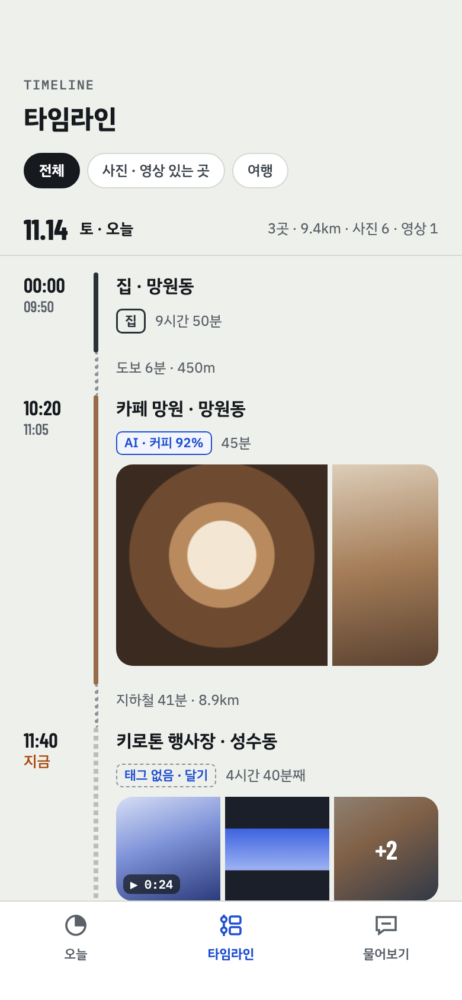
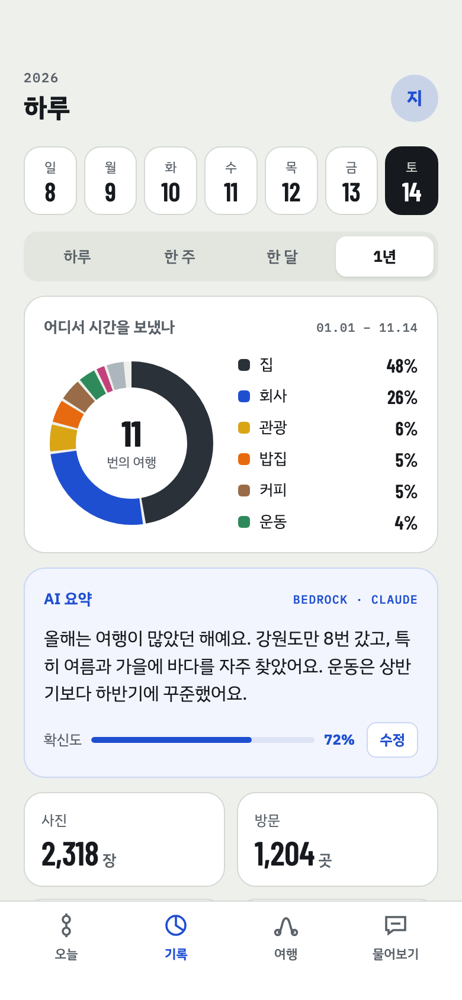
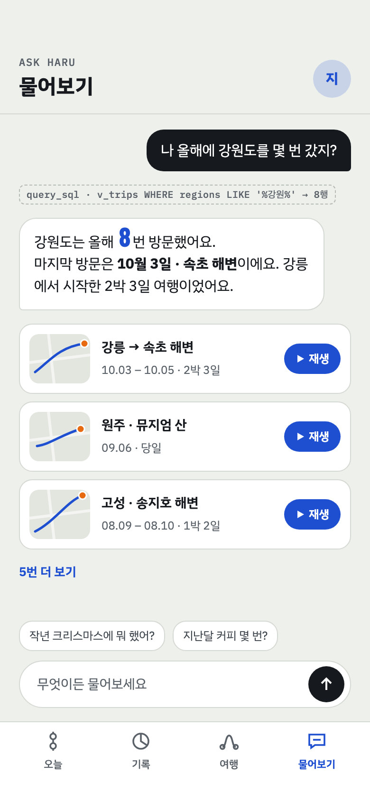

# 하루 (Haru)

> **기록하지 않아도 기억되는 하루.**
> 핸드폰이 위치·사진·시간으로 하루를 자동 기록하고, AI가 "그때 무엇을 했는지" 정리해 주는 개인 라이프로그 앱

키로톤(Kiro 해커톤) · 팀 Kiro비컴휴먼 (team-018) · 기획서 v0.2 · 2026-11-14

| 문서 | 내용 |
|---|---|
| **이 README** | 통합 기획서 (아래) |
| [site/index.html](site/index.html) | **발표 사이트** (동기부여 → 차별점 → 시현 → 마무리, 시연 영상 포함) |
| [design/haru-mockup.html](design/haru-mockup.html) | 화면 목업 v0.4 (오늘 24시간 도넛 · 타임라인 사진/영상 · 물어보기) |
| [design/haru-app-design.html](design/haru-app-design.html) | 앱 전체 디자인 v0.1 (온보딩 · 오늘 · 물어보기 · 재생 · 여행 · 태그) |
| [docs/PLAN.md](docs/PLAN.md) | 기능 기획 상세 (데이터 모델, 기억 챗, 더미 데이터 설계) |
| [docs/system-design.html](docs/system-design.html) | 시스템 설계 (기기 SQLite, Lambda 중계, Bedrock 에이전트) |
| [docs/user-stories.html](docs/user-stories.html) | 유저 스토리 맵 |
| [docs/하루_기획서_v0.1.md](docs/하루_기획서_v0.1.md) | `feat/haru-planning` 브랜치 원본 기획서 |

---

## 1. 서비스 개요

| 항목 | 내용 |
|---|---|
| 서비스명 | 하루 (Haru) |
| 한 줄 설명 | 핸드폰이 기억하는 나의 하루 |
| 핵심 가치 | 아무것도 입력하지 않아도 하루가 기록되고, 나중에 물어보면 찾아 준다 |
| 타깃 유저 | 자신의 시간과 행동 패턴을 되돌아보고 싶은 사람, 여행을 기록하고 싶은 사람 |

### 본질: 위치 추적 앱이 아니다

하루는 **"적지 않아도 쓰이는 일기"** 이자 **"내 삶의 검색엔진"** 이다. 사용자가 원하는 건 GPS 로그가 아니라 *"그때 나는 어디서 뭘 했지?"* 에 대한 답이다.

| 단계 | 하는 일 | 본질 |
|---|---|---|
| 입력 | 위치·사진 자동 수집 | **노력 0의 기록** |
| 의미화 | 좌표 → 머문 곳 → 무엇을 했나 | **좌표를 "기억 단위"로 바꾸는 엔진** (핵심 기술) |
| 회상 | 24시간 도넛 · 지도 재생 · 질문 | 요약 = **패턴**, 재생 = **감성**, 질문 = **효용** |

### 핵심 원칙

1. **가치의 단위는 좌표가 아니라 "머문 곳(Visit)"이다.** 하루 수천 개 점이 10여 개 방문으로 압축된다. 방문 감지 품질이 곧 제품 품질이다.
2. **사람은 여행·사건 단위로 기억한다.** "강원도 몇 번 갔지?"에 답하려면 Trip 감지와 행정구역 계층(시/도 → 시/군/구 → 동)이 필요하다.
3. **LLM은 데이터를 읽지 않고 조회한다.** 질문을 도구 호출로 바꾸고, 답에는 반드시 근거 카드를 붙인다. 데이터가 없으면 "기록이 없어요"라고 말한다.
4. **콜드 스타트는 더미 데이터로 푼다.** 12개월 치 원시 데이터를 생성해 엔진을 그대로 통과시킨다.
5. **위치는 가장 민감한 데이터다.** 기기 내 처리 우선, 집·회사 마스킹, 기간 삭제, 기록 일시정지를 처음부터 넣는다.

---

## 2. 핵심 기능

### 2-1. 자동 수집
- **위치**: 백그라운드 수집. iOS는 CLVisit처럼 **방문 단위**(도착~출발)로 들어온다 ([샘플](docs/data/ios-visit-sample.json))
- **사진 (EXIF)**: 촬영 시각·위치를 방문에 매칭해 기억에 사진을 붙인다
- **날짜/시간**: 타임스탬프 기반 타임라인 자동 생성

### 2-2. 의미화 엔진 + 장소 태그
- 방문 → 장소(역지오코딩, 행정구역) → 태그 → 하루(Day) / 여행(Trip)
- **태그는 장소에 붙는다.** 한 번 달면 그 장소의 모든 방문에 적용된다
- **태그 목록은 닫혀 있다**: `집` `회사` `밥집` `커피` `운동` `쇼핑` `관광`
- AI는 목록 안에서 하나를 고르고 **확신도(%)** 와 근거를 남긴다. 확신이 없으면 비워 둔다
- 사람 태그가 최우선. AI는 사람 태그를 덮어쓰지 않고, 사람의 수정은 다음 추론에 반영된다

### 2-3. 메인 화면: 24시간 도넛
- 앱을 열면 바로 보이는 **오늘** 화면이 커다란 도넛 하나다
- **하루**: 24시간 시계. 0시가 맨 위이고 시계 방향으로 돈다. 머문 곳이 실제 시간 위치에 태그 색으로 칠해지고, 지금 위치는 주황 점, 아직 오지 않은 시간은 비어 있다
- 가운데: 평소엔 "지금 머무는 곳 · 머문 시간", 조각이나 목록을 누르면 그 태그의 시간과 구간
- **한 주 / 한 달 / 1년**: 태그별 비중 도넛 + 지난 기간 대비 증감(▲▼)
- 도넛 아래: 태그별 시간 목록 → **AI 요약 카드**(확신도 · 수정) → 스탯(머문 곳 · 이동 거리 · 사진 · 첫 활동) → 기간별 상세(머문 곳 목록 / 요일별 미니 도넛 / 많이 간 지역)
- 하루를 원형 시간표로 보여주는 방식은 자동 시간 기록 앱 Life Cycle에서 착안했다. 색·글꼴·구성은 하루 디자인 시스템을 따른다

### 2-4. 타임라인 탭 (사진 · 영상 · 여행)
- 하단 두 번째 탭. 기존 "여행" 탭을 대신한다
- 날짜별로 머문 곳이 시간순 세로 타임라인으로 쌓인다. 레일 색 = 장소 태그, 점선 = 이동(수단 · 시간 · 거리)
- **장소마다 그때 찍은 사진과 영상**이 붙는다. 촬영 시각·위치(EXIF)로 방문에 자동 연결한다. 3장까지 보여주고 나머지는 `+N`, 영상은 길이 표시. 누르면 크게 본다
- **여행은 타임라인 안의 묶음 카드**로 나온다 (커버 사진, 기간 · 장소 수 · 거리 · 사진 수, 사진 스트립, [재생] → 지도 재생)
- 필터: 전체 / 사진 · 영상 있는 곳 / 여행
- 지도 재생: 날짜 · 기간 · 여행을 고르면 점이 시간 순으로 이동하고, 머문 곳에서 멈춰 라벨과 사진을 띄운다. 배속 조절

### 2-5. 자연어 질문 (기억 챗)
- 예: "올해 강원도 몇 번 갔지?" → "8번이에요. 마지막: 2026-10-03 · 속초 해변" + 근거 카드
- 흐름: 질문 → 앱이 **Lambda 중계(`/chat`)** 를 거쳐 Bedrock Converse 호출 → 모델이 `query_sql`로 폰의 `memory.db` 읽기 전용 뷰를 조회 (최대 6회) → `final_answer {text, cards[ID]}` → 앱이 카드 ID를 로컬 DB에서 다시 조회해 근거 카드를 만든다
- 카드 내용은 모델이 쓴 글자가 아니라 DB 조회 결과다. 모델이 날짜를 지어내도 카드는 틀리지 않는다
- 근거 카드를 누르면 그 날 / 그 여행을 재생한다
- 자세한 루프와 SQL 가드: [시스템 설계 3–4장](docs/system-design.html)

| 질문 예시 | 유형 | 조회하는 뷰 |
|---|---|---|
| "저번에 강원도 갔던 게 며칠이었지?" | 여행 회상 | `v_trips` |
| "작년 크리스마스에 뭐 했어?" | 특정 날 | `v_days` · `v_stays` |
| "성수동에서 갔던 그 파스타집 어디였지?" | 장소 찾기 | `v_places` · `v_stays` |
| "지난달 커피 몇 번 마셨어?" | 집계 | `v_stays` ⨝ `v_places` (tag) |
| "올해 강원도 몇 번 갔지?" | 집계 | `v_trips` (regions) |

---

## 3. 화면 구성

목업: **[design/haru-mockup.html](design/haru-mockup.html)** (브라우저에서 열기. 기간 탭과 도넛 조각을 누를 수 있다)

| 오늘 · 하루 | 타임라인 | 오늘 · 1년 | 물어보기 |
|---|---|---|---|
|  |  |  |  |

```
┌─────────────────────────────┐
│  11.14 오늘          ● 기록 중 │  ← 날짜
├─────────────────────────────┤
│  [ 하루 | 한 주 | 한 달 | 1년 ]│  ← 기간 탭
├─────────────────────────────┤
│        ╭──── 0 ────╮         │
│      18   지금 4h 40m   6     │  ← 24시간 도넛 (메인)
│        ╰──── 12 ───╯         │
├─────────────────────────────┤
│  태그별 시간 + 증감 ▲▼          │
├─────────────────────────────┤
│  AI 요약 카드                 │  ← 확신도 + 수정
├─────────────────────────────┤
│  머문 곳 | 이동 | 사진 | 첫 활동 │  ← 스탯
├─────────────────────────────┤
│  머문 곳 목록 / 요일별 링 / 지역  │  ← 기간별 상세
└─────────────────────────────┘
  [ 오늘 ]   [ 타임라인 ]   [ 물어보기 ]
```

한 주 화면 캡처: [design/mockup/week.png](design/mockup/week.png). 나머지 화면(온보딩, 여행 재생, 오늘의 하루 카드, 태그 정리, 태그 달기)은 [앱 전체 디자인 v0.1](design/haru-app-design.html)에 있다. v0.1의 "여행" 탭은 이번 목업에서 "타임라인" 탭으로 바뀌었다.

---

## 4. 데이터 모델

```
Visit                                    ← iOS 방문 원본 (도착~출발)
  id, lat, lng, horizontal_accuracy
  arrived_at, left_at?                   // left_at = null 이면 아직 머무는 중
  place_id → Place
  photos: [Photo]

Place                                    ← 좌표 클러스터
  name, lat, lng, region (시/도 > 시/군/구 > 동)
  tag        : 집 | 회사 | 밥집 | 커피 | 운동 | 쇼핑 | 관광 | null
  tag_source : human | ai | null
  ai_confidence : Float                  // 0.87
  ai_reason  : String                    // 고른 근거, 또는 비워 둔 이유

Photo   { id, taken_at, lat, lng, visit_id? }
Day     { date, visits, distance_km, first_activity_at, summary }
Trip    { start, end, regions, visits }  ← 집 기준 생활권을 벗어난 구간
```

- 위는 개념 모델이다. 실제 SQLite DDL(`raw.db`의 points, `memory.db`의 places · stays · moves · trips · days, 에이전트용 뷰)은 [시스템 설계 5장](docs/system-design.html)이 기준이다
- 에이전트용 뷰에는 좌표가 없고, 집·회사는 이름이 "집", "회사"로만 나온다
- `horizontal_accuracy`가 35~80m로 크다. 장소 매칭 반경(약 100m)에 반영한다
- 방문 사이 이동 경로는 원본에 없다. 지도 재생 경로는 별도 수집하거나 보간한다

---

## 5. 기술 스택

| 영역 | 기술 |
|---|---|
**서버 DB는 두지 않는다.** 데이터는 전부 폰의 SQLite에 있고, 앱은 Lambda 함수 하나(Function URL)를 거쳐 Bedrock과 Kakao를 호출한다. API 키와 AWS 자격 증명은 앱에도 GitHub에도 없다. ([시스템 설계](docs/system-design.html))

| 영역 | 기술 |
|---|---|
| 앱 | React Native (Expo) · iOS + Android |
| 위치 수집 | `expo-location` + `expo-task-manager` |
| 사진 | `expo-media-library` (EXIF) |
| 차트 | `react-native-svg` + `d3-shape` |
| 상태 · 내비게이션 | Zustand · React Navigation v7 |
| 저장 | 기기 SQLite 2개: `raw.db` (원시 좌표, 에이전트 접근 불가) · `memory.db` (장소·방문·여행·하루) |
| 중계 | Lambda 1개 + Function URL: `/chat` → Bedrock, `/geocode` → Kakao · 모델·`maxTokens` 서버 고정 · 예약 동시성 5 · URL은 `.env`(gitignore) |
| LLM | Amazon Bedrock Converse · `global.openai.gpt-6-luna` (ap-northeast-2) · 태그 추론 + 기억 챗 |
| 장소 · 행정구역 | Kakao Local API (키는 Lambda 환경변수에만) · 더미 데이터는 생성기의 장소명을 그대로 사용 |
| 비용 방어 | AWS Budgets 도달 시 Lambda 동시성 0 · CloudWatch 경보 (요청 본문은 로그에 남기지 않음) |

쓰지 않는 것: API Gateway, DynamoDB, RDS, S3, Cognito

**권한**: iOS `NSLocationAlwaysAndWhenInUseUsageDescription`, Android `ACCESS_BACKGROUND_LOCATION`

**프라이버시**: 데이터는 기기에만 저장 · AI에는 뷰 스키마와 SQL 결과 행만 전달 (원시 좌표, 집·회사 위치는 보내지 않음) · 지오코딩에는 원시 점이 아니라 장소 중심점만 보냄 · 기간 삭제 · 기록 일시정지

---

## 6. 범위

| 기능 | 해커톤 | 이후 |
|---|---|---|
| 위치 자동 수집 · 더미 데이터 생성기 | ✅ | |
| 의미화 엔진 · 장소 태그 | ✅ | |
| 타임라인 탭 · 지도 재생 | ✅ | |
| 메인 24시간 도넛 · 기간별 비중 도넛 + AI 요약 | ✅ | |
| 자연어 질문 (근거 카드) | ✅ | |
| 사진 · 영상 연동 (타임라인에 표시) | ✅ | |
| 오늘의 하루 카드 푸시 · 1년 전 오늘 | 여유 있으면 | ✅ |
| 클라우드 백업 · 소셜 공유 · 영상 내보내기 | | 2차 |
| Apple Watch 연동 | | 3차 |

**만들지 않을 것**: 회원가입·소셜, ML 분류 모델, 완벽한 배터리 최적화, 멀티 디바이스 동기화

---

## 7. 데모 시나리오 (3분)

1. 12개월 치 더미 데이터가 들어 있는 상태로 시작한다 (서울 직장인 페르소나)
2. **메인 화면**: 오늘 24시간 도넛 → 1년 탭으로 바꿔 한 해 패턴을 보여준다
3. **질문**: "나 올해에 강원도를 몇 번 갔지?" → "강원도는 올해 **8번** 방문했어요. 마지막 방문: 2026-10-03 · 속초 해변" + 근거 카드
4. 카드의 [재생]을 누르면 지도 위에서 서울 → 강릉 → 속초 → 서울이 흐른다

---

## 8. 역할 분담 (제안)

| 담당 | 범위 |
|---|---|
| A · 앱 | 수집, 메인 도넛 화면, 타임라인(사진 · 영상), 지도 재생 |
| B · 엔진 | 더미 데이터 생성기, 방문/여행 감지, 역지오코딩, 태그 추론 |
| C · 챗 | Lambda 중계 · Bedrock 설정, 에이전트 런타임 (SQL 가드, 도구 루프, 카드 조립) |

B가 SQLite DDL을 먼저 고정하면 A와 C는 목업 데이터로 병렬 개발할 수 있다. 구현 순서는 [시스템 설계 9장](docs/system-design.html)에 있다.

---

## 9. 결정 사항과 남은 질문

세 문서(`docs/PLAN.md`, `feat/haru-planning` 기획서, `docs/system-design.html`)를 합치면서 서로 달랐던 부분이다.

**정해진 것**
- [x] **LLM**: Bedrock `gpt-6-luna` 하나로 통일 (원본 브랜치의 GPT-4o mini 직접 호출은 쓰지 않음)
- [x] **데이터 저장 위치**: 기기에만 저장. 백업은 이번 범위에서 뺀다
- [x] **가입**: 해커톤은 로그인 없이 간다
- [x] **Bedrock 호출 경로**: Lambda 중계 1개 (Cognito 직접 호출안은 철회)
- [x] **지오코딩**: Kakao Local API를 Lambda로 중계
- [x] **사진 · 영상 연동**: MVP에 넣는다. 타임라인 탭의 핵심이다
- [x] **분류 체계**: 닫힌 태그 7개 (`기타` 없음, 모르면 비움). 원본 브랜치의 `HOME/CAFE/GYM/TRANSIT/OTHER`는 쓰지 않음

**남은 것**
- [ ] **`gpt-6-luna` 도구 호출 지원 여부**: 구현 첫날 확인. 안 되면 JSON 출력 모드로 같은 루프를 만든다
- [ ] **방문 기준**: 15분 vs 10분 이상 머무름 (iOS Visit 원본을 쓰면 OS 기준을 따른다)
- [ ] **1차 타깃**: 여행 기록 vs 일상 회고

---

---

## 10. 발표 사이트 · 배포

`site/` 폴더가 발표 사이트다. 빌드 도구 없이 HTML 하나로 돌아간다.

| 막 | 내용 |
|---|---|
| 표지 | 하루 · 24시간 도넛 |
| 1 동기부여 | ① 칸 없이 흩어진 1–27 숫자 찾기 (타이머) → ② 같은 배치에 9칸을 그어 바로 찾게 함: "나뉘어 있으면 찾을 수 있다" → ③ "그때 나는 어디서 뭘 했지?" 질문 세 개 |
| 2 한계 · 차별점 | 위치 기록 / 사진 앱 / 일기 앱 / 시간 기록 앱 비교표 + 차별점 4개 |
| 3 시현 | 왼쪽에 실제 목업 앱, 오른쪽에 페이지별 설명. 9단계 (하루 도넛 → 조각 → 태그 → 1년 → 타임라인 → 영상 → 여행 → 물어보기 → 근거 카드) |
| 4 마무리 | 요약 4개, 프라이버시 · 기술, 시연 영상 |

**조작**: `←` `→` (또는 스페이스)로 넘긴다. 시현 슬라이드에서는 단계가 먼저 넘어가고, 단계에 맞춰 왼쪽 앱이 자동으로 눌린다. `N` 키로 발표 대본을 띄운다 (영상 녹화용).

**시연 영상**: `site/media/demo.mp4`에 넣으면 마무리 슬라이드에서 재생된다. H.264 · 1080p · 50MB 이하 권장 (GitHub 파일 한도 100MB).

**로컬에서 열기** (발표장 오프라인 대비):

```bash
mkdir -p site/app && cp design/haru-mockup.html site/app/ && python3 -m http.server 8765
```

→ `http://localhost:8765/site/`. 목업 원본은 `design/haru-mockup.html` 하나이고, `site/app/`은 복사본이라 커밋하지 않는다.

**배포 (AWS Amplify Hosting)**: 저장소 루트의 [`amplify.yml`](amplify.yml)이 목업을 `site/app/`에 복사한 뒤 `site/`만 배포한다.

1. AWS 콘솔(개인 프로필 계정, 리전 `ap-northeast-2`) → Amplify → **Deploy an app** → GitHub → `ghdmsrkd/team-018`, 브랜치 `main`
2. 빌드 설정은 `amplify.yml`을 자동으로 읽는다. 그대로 저장하고 배포
3. 이후 `main`에 push할 때마다 자동 재배포. 주소는 `https://main.<앱 ID>.amplifyapp.com`

---

*하루 — 아무것도 입력하지 않아도 나를 기억해줘요.*
