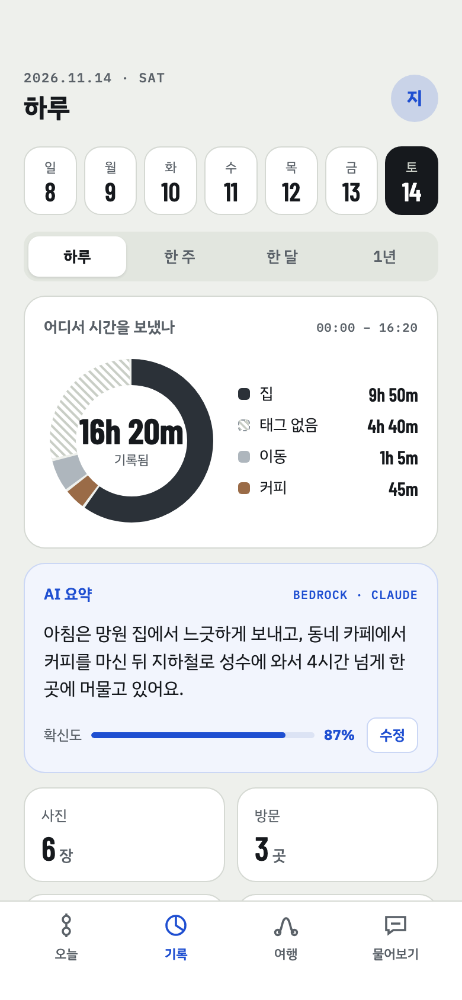

# 하루 (Haru)

> **기록하지 않아도 기억되는 하루.**
> 핸드폰이 위치·사진·시간으로 하루를 자동 기록하고, AI가 "그때 무엇을 했는지" 정리해 주는 개인 라이프로그 앱

키로톤(Kiro 해커톤) · 팀 018 · 기획서 v0.2 · 2026-11-14

| 문서 | 내용 |
|---|---|
| **이 README** | 통합 기획서 (아래) |
| [design/haru-mockup.html](design/haru-mockup.html) | 기록 요약 화면 목업 (도넛 차트 · AI 요약 · 1년 뷰 · 질문) |
| [design/haru-app-design.html](design/haru-app-design.html) | 앱 전체 디자인 v0.1 (온보딩 · 오늘 · 물어보기 · 재생 · 여행 · 태그) |
| [docs/PLAN.md](docs/PLAN.md) | 기능 기획 상세 (데이터 모델, 기억 챗, 더미 데이터 설계) |
| [docs/user-stories.html](docs/user-stories.html) | 유저 스토리 맵 |
| [docs/하루_기획서_v0.1.md](docs/하루_기획서_v0.1.md) | `feat/haru-planning` 브랜치 원본 기획서 |

---

## 1. 서비스 개요

| 항목 | 내용 |
|---|---|
| 서비스명 | 하루 (Haru) |
| 한 줄 설명 | 핸드폰이 기억하는 나의 하루 |
| 핵심 가치 | 아무것도 입력하지 않아도 하루가 기록되고, 나중에 물어보면 찾아 준다 |
| 타깃 유저 | 자신의 시간과 행동 패턴을 되돌아보고 싶은 사람, 여행을 기록하고 싶은 사람 |

### 본질: 위치 추적 앱이 아니다

하루는 **"적지 않아도 쓰이는 일기"** 이자 **"내 삶의 검색엔진"** 이다. 사용자가 원하는 건 GPS 로그가 아니라 *"그때 나는 어디서 뭘 했지?"* 에 대한 답이다.

| 단계 | 하는 일 | 본질 |
|---|---|---|
| 입력 | 위치·사진 자동 수집 | **노력 0의 기록** |
| 의미화 | 좌표 → 머문 곳 → 무엇을 했나 | **좌표를 "기억 단위"로 바꾸는 엔진** (핵심 기술) |
| 회상 | 기록 요약 · 지도 재생 · 질문 | 요약 = **패턴**, 재생 = **감성**, 질문 = **효용** |

### 핵심 원칙

1. **가치의 단위는 좌표가 아니라 "머문 곳(Visit)"이다.** 하루 수천 개 점이 10여 개 방문으로 압축된다. 방문 감지 품질이 곧 제품 품질이다.
2. **사람은 여행·사건 단위로 기억한다.** "강원도 몇 번 갔지?"에 답하려면 Trip 감지와 행정구역 계층(시/도 → 시/군/구 → 동)이 필요하다.
3. **LLM은 데이터를 읽지 않고 조회한다.** 질문을 도구 호출로 바꾸고, 답에는 반드시 근거 카드를 붙인다. 데이터가 없으면 "기록이 없어요"라고 말한다.
4. **콜드 스타트는 더미 데이터로 푼다.** 12개월 치 원시 데이터를 생성해 엔진을 그대로 통과시킨다.
5. **위치는 가장 민감한 데이터다.** 기기 내 처리 우선, 집·회사 마스킹, 기간 삭제, 기록 일시정지를 처음부터 넣는다.

---

## 2. 핵심 기능

### 2-1. 자동 수집
- **위치**: 백그라운드 수집. iOS는 CLVisit처럼 **방문 단위**(도착~출발)로 들어온다 ([샘플](docs/data/ios-visit-sample.json))
- **사진 (EXIF)**: 촬영 시각·위치를 방문에 매칭해 기억에 사진을 붙인다
- **날짜/시간**: 타임스탬프 기반 타임라인 자동 생성

### 2-2. 의미화 엔진 + 장소 태그
- 방문 → 장소(역지오코딩, 행정구역) → 태그 → 하루(Day) / 여행(Trip)
- **태그는 장소에 붙는다.** 한 번 달면 그 장소의 모든 방문에 적용된다
- **태그 목록은 닫혀 있다**: `집` `회사` `밥집` `커피` `운동` `쇼핑` `관광`
- AI는 목록 안에서 하나를 고르고 **확신도(%)** 와 근거를 남긴다. 확신이 없으면 비워 둔다
- 사람 태그가 최우선. AI는 사람 태그를 덮어쓰지 않고, 사람의 수정은 다음 추론에 반영된다

### 2-3. 기록 요약 (도넛 차트)
- **하루 / 한 주 / 한 달 / 1년** 탭 전환
- 태그별 체류 시간 비중을 도넛 차트로 표시
- 그 아래 **AI 요약 카드** (확신도 · 수정 버튼)와 **스탯 카드** 2×2 (사진 수 · 방문 수 · 이동 거리 · 첫 활동)

### 2-4. 하루 타임라인 · 지도 재생
- 날짜 선택 → 세로 타임라인 + 지도
- 날짜/기간/여행을 고르면 점이 시간 순으로 이동하고, 머문 곳에서 멈춰 라벨을 띄운다. 배속 조절

### 2-5. 자연어 질문 (기억 챗)
- 예: "올해 강원도 몇 번 갔지?" → "8번이에요. 마지막: 2026-10-03 · 속초 해변" + 근거 카드
- 흐름: 질문 → 백엔드 → **Amazon Bedrock (Claude) tool use** → 방문 DB 조회 → 근거 카드와 함께 답변
- 근거 카드를 누르면 그 날 / 그 여행을 재생한다

| 질문 예시 | 유형 | 도구 |
|---|---|---|
| "저번에 강원도 갔던 게 며칠이었지?" | 여행 회상 | `find_trips(region)` |
| "작년 크리스마스에 뭐 했어?" | 특정 날 | `get_day_summary(date)` |
| "성수동에서 갔던 그 파스타집 어디였지?" | 장소 찾기 | `search_places(area, tag)` |
| "지난달 커피 몇 번 마셨어?" | 집계 | `stats(tag, range)` |
| "올해 강원도 몇 번 갔지?" | 집계 | `stats(region, range)` |

---

## 3. 화면 구성

목업: **[design/haru-mockup.html](design/haru-mockup.html)** (브라우저에서 열기)

| 기록 요약 · 하루 | 기록 요약 · 1년 | 물어보기 |
|---|---|---|
|  |  |  |

```
┌─────────────────────────────┐
│  하루                [아바타] │  ← 상단
├─────────────────────────────┤
│  날짜 스트립 (가로 스크롤)      │  ← 날짜 선택
├─────────────────────────────┤
│  [ 하루 | 한 주 | 한 달 | 1년 ]│  ← 기간 탭
├─────────────────────────────┤
│  도넛 차트 + 범례              │  ← 태그별 체류 비중
├─────────────────────────────┤
│  AI 요약 카드                 │  ← 확신도 + 수정
├─────────────────────────────┤
│  사진 수 | 방문 수             │  ← 스탯 카드 2×2
│  이동 거리 | 첫 활동           │
├─────────────────────────────┤
│  타임라인 (장소별)             │
├─────────────────────────────┤
│  질문 입력창                  │  ← 기억 챗으로 이동
└─────────────────────────────┘
```

나머지 화면(온보딩, 오늘, 물어보기, 여행 재생, 여행 목록, 오늘의 하루 카드, 태그 정리, 태그 달기)은 [앱 전체 디자인](design/haru-app-design.html)에 있다.

---

## 4. 데이터 모델

```
Visit                                    ← iOS 방문 원본 (도착~출발)
  id, lat, lng, horizontal_accuracy
  arrived_at, left_at?                   // left_at = null 이면 아직 머무는 중
  place_id → Place
  photos: [Photo]

Place                                    ← 좌표 클러스터
  name, lat, lng, region (시/도 > 시/군/구 > 동)
  tag        : 집 | 회사 | 밥집 | 커피 | 운동 | 쇼핑 | 관광 | null
  tag_source : human | ai | null
  ai_confidence : Float                  // 0.87
  ai_reason  : String                    // 고른 근거, 또는 비워 둔 이유

Photo   { id, taken_at, lat, lng, visit_id? }
Day     { date, visits, distance_km, first_activity_at, summary }
Trip    { start, end, regions, visits }  ← 집 기준 생활권을 벗어난 구간
```

- `horizontal_accuracy`가 35~80m로 크다. 장소 매칭 반경(약 100m)에 반영한다
- 방문 사이 이동 경로는 원본에 없다. 지도 재생 경로는 별도 수집하거나 보간한다

---

## 5. 기술 스택

| 영역 | 기술 |
|---|---|
| 앱 | React Native (Expo) · iOS + Android |
| 위치 수집 | `expo-location` + `expo-task-manager` (또는 `react-native-background-geolocation`) |
| 사진 | `expo-media-library` (EXIF) |
| 차트 | `react-native-svg` + `d3-shape` |
| 상태 · 로컬 저장 | Zustand · MMKV + SQLite |
| 내비게이션 | React Navigation v7 |
| API 서버 | Node.js (Fastify) 또는 Python (FastAPI) |
| 장소 · 행정구역 | Kakao Local API (한국 POI 정확도) |
| 지도 | Kakao Map / Mapbox / Amazon Location Service |
| LLM | Amazon Bedrock (Claude) · 태그 추론 + 기억 챗 |
| 저장 | PostgreSQL + PostGIS |

**권한**: iOS `NSLocationAlwaysAndWhenInUseUsageDescription`, Android `ACCESS_BACKGROUND_LOCATION`

**프라이버시**: 위치는 기기 내 처리 우선 · 클라우드 업로드 시 암호화 · LLM에 개인 식별 정보 미전송 · 집/회사 마스킹 · 기간 삭제 · 기록 일시정지

---

## 6. 범위

| 기능 | 해커톤 | 이후 |
|---|---|---|
| 위치 자동 수집 · 더미 데이터 생성기 | ✅ | |
| 의미화 엔진 · 장소 태그 | ✅ | |
| 하루 타임라인 · 지도 재생 | ✅ | |
| 기록 요약 (하루/주/월/년 도넛 + AI 요약) | ✅ | |
| 자연어 질문 (근거 카드) | ✅ | |
| 사진 연동 | 여유 있으면 | ✅ |
| 오늘의 하루 카드 푸시 · 1년 전 오늘 | 여유 있으면 | ✅ |
| 클라우드 백업 · 소셜 공유 · 영상 내보내기 | | 2차 |
| Apple Watch 연동 | | 3차 |

**만들지 않을 것**: 회원가입·소셜, ML 분류 모델, 완벽한 배터리 최적화, 멀티 디바이스 동기화

---

## 7. 데모 시나리오 (3분)

1. 12개월 치 더미 데이터가 들어 있는 상태로 시작한다 (서울 직장인 페르소나)
2. **기록 요약**: 오늘 도넛 → 1년 탭으로 바꿔 한 해 패턴을 보여준다
3. **질문**: "나 올해에 강원도를 몇 번 갔지?" → "강원도는 올해 **8번** 방문했어요. 마지막 방문: 2026-10-03 · 속초 해변" + 근거 카드
4. 카드의 [재생]을 누르면 지도 위에서 서울 → 강릉 → 속초 → 서울이 흐른다

---

## 8. 역할 분담 (제안)

| 담당 | 범위 |
|---|---|
| A · 앱 | 수집, 타임라인, 기록 요약 차트, 지도 재생 |
| B · 엔진 | 더미 데이터 생성기, 방문/여행 감지, 역지오코딩, 태그 추론 |
| C · 챗 | Bedrock 에이전트, 도구 정의, 근거 카드 응답 포맷 |

B가 4장 스키마를 먼저 고정하면 A와 C는 목업 데이터로 병렬 개발할 수 있다.

---

## 9. 팀이 정해야 할 것

두 기획서(`docs/PLAN.md`, `feat/haru-planning`)를 합치면서 서로 달랐던 부분이다. 위 본문은 앞쪽 안을 기준으로 썼다.

- [ ] **LLM 하나로 통일?** 원본 브랜치는 태그 추론에 GPT-4o mini, 챗에 Bedrock을 썼다 → 본문은 Bedrock(Claude) 하나로 통일
- [ ] **분류 체계**: `HOME/CAFE/GYM/TRANSIT/OTHER` vs 닫힌 태그 7개(`기타` 없음, 모르면 비움) → 본문은 태그 7개
- [ ] **방문 기준**: 15분 vs 10분 이상 머무름 (iOS Visit 원본을 쓰면 OS 기준을 따른다)
- [ ] **사진 연동 시점**: MVP 포함 vs 이후 → 본문은 "여유 있으면"
- [ ] **데이터 저장 위치**: 서버 vs 기기 (프라이버시 메시지와 직결)
- [ ] **1차 타깃**: 여행 기록 vs 일상 회고

---

*하루 — 아무것도 입력하지 않아도 나를 기억해줘요.*
